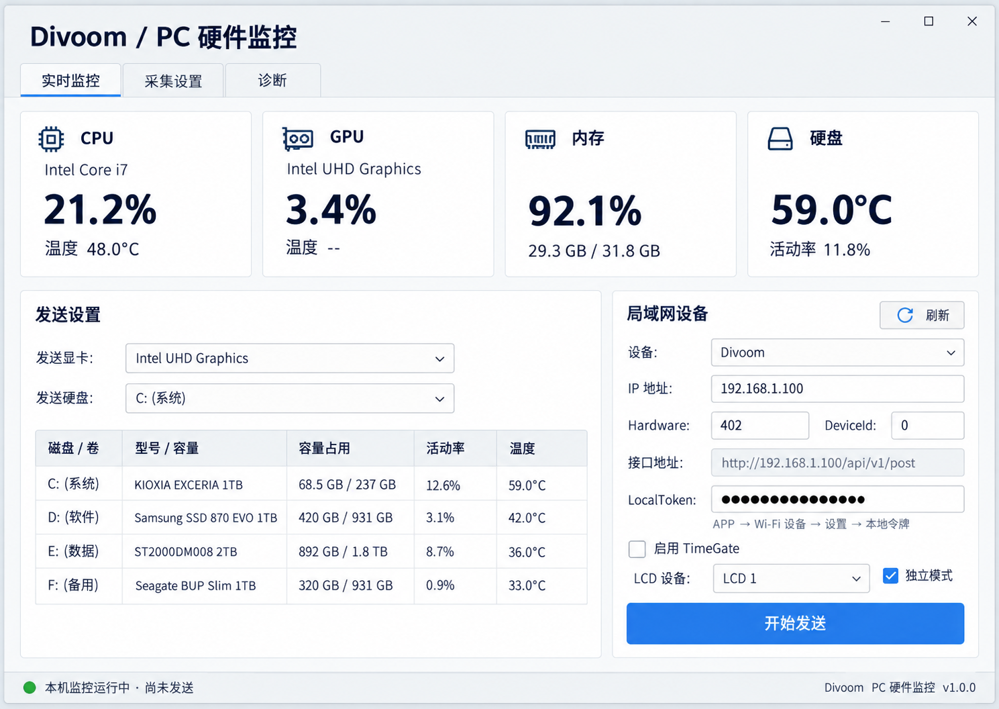

# Windows dashboard v1.2.0

Layout concept generated using the built-in imagegen tool (ui-mockup), then implemented with native WinForms controls in MainForm.cs. The image is a design reference; sample values and endpoint text are illustrative. Runtime metrics and endpoint routing come from the application.

Implementation uses four metric cards, a left disk table with source selectors, and a separate scrollable connection panel on the right. Explicit row heights prevent preferred-size feedback from collapsing the table. The status line stays outside both panels. Localization no longer changes button sizing during every sensor refresh.

## Generation prompt

Use case: ui-mockup
Asset type: high fidelity desktop application layout reference, landscape 1100 x 780 proportions.
Primary request: redesign the Divoom PC hardware monitoring application in Simplified Chinese for a practical native Windows desktop UI.
Style: clean light gray background, white panels, navy typography, restrained blue primary button, crisp native input controls, generous consistent spacing, no decorative charts.
Composition: Header "Divoom / PC 硬件监控", tabs "实时监控", "采集设置", "诊断". Top row four equal cards CPU / GPU / 内存 / 硬盘 showing model name, large usage or temperature value and secondary metric. Below cards, two columns: wider left panel contains "发送显卡" and "发送硬盘" dropdowns on separate rows then a visible five column disk and volume table. Narrower right panel titled "局域网设备" contains refresh button plus device dropdown, IP field, Hardware and DeviceId paired fields, endpoint text, LocalToken masked field, help text "APP → Wi-Fi 设备 → 设置 → 本地令牌", TimeGate checkbox with LCD dropdown and independent mode checkbox, and full width "开始发送" blue button. Bottom status line. Everything must fit within window with no overlapping, cropping or controls hidden behind others.
Text: CPU "Intel Core i7", "21.2%", "温度 48.0°C"; GPU "Intel UHD Graphics", "3.4%", "温度 --"; memory "92.1%", "29.3 GB / 31.8 GB"; disk "59.0°C", "活动率 11.8%". IP generic "192.168.1.100"; Hardware "402"; DeviceId "0". Table headings "磁盘 / 卷", "型号 / 容量", "容量占用", "活动率", "温度". Status "本机监控运行中 · 尚未发送".
Constraints: real achievable native WinForms desktop design, all listed controls visible, readable Chinese text, do not add features, do not show any actual token, no mobile frame, no glowing effects, no imaginary graphs. Screenshot-style straight-on flat UI.

