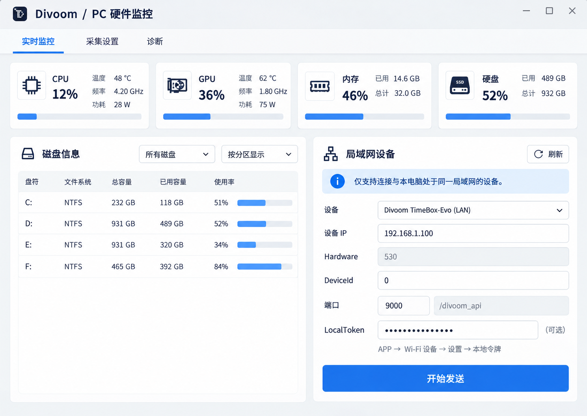

# LAN notice / Tauri migration

Generated with built-in imagegen, use case ui-mockup. The selected design element is the persistent pale-blue same-LAN information banner above device selection. Illustrative metrics and unrelated elements in the image are not additional product requirements. The runtime interface uses selectable, localized native web text rather than a bitmap label.

## Prompt

Use case: ui-mockup
Asset type: high fidelity desktop application design reference.
Primary request: add one clear same-local-network notice to the LAN device connection area of an existing Divoom PC hardware monitor. Do not redesign other application sections.
Style: native desktop UI, light gray background, white cards, navy text, restrained blue accents. Flat straight-on screenshot, landscape proportions about 1100 by 780.
Composition: header "Divoom / PC 硬件监控"; tabs "实时监控", "采集设置", "诊断"; four small CPU, GPU, 内存, 硬盘 metric cards across the top. Left lower area disk table and two dropdowns. Right lower area a LAN device card with title "局域网设备" and refresh button. Directly below this title, a pale blue information banner with a small circled i, dark blue readable Chinese message. The banner has no close button and sits above the device dropdown and IP input. Connection settings scroll beneath the notice if needed, while the blue "开始发送" button stays fully visible at the bottom.
Text (verbatim for the new banner): "仅支持连接与本电脑处于同一局域网的设备。"
Other right card fields: device dropdown, "设备 IP" input using generic 192.168.1.100, "Hardware" 530, "DeviceId" 0, endpoint "端口 9000 /divoom_api", "LocalToken" masked optional input and "APP → Wi-Fi 设备 → 设置 → 本地令牌". Hide TimeGate LCD options for Hardware 530.
Constraints: the new notice is always visible in the connection card, clear hierarchy, 10 to 14 pixels padding, enough height for wrapping translations, all native controls separated without overlap. Preserve readable disk table and existing metrics. No popup, no invented connectivity validation, no real device token, no additional features or graphs, no change to protocol. Values are illustrative.
